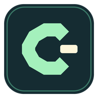

  

<h1 align="center">T3C Code</h1>

  <a href="https://github.com/sunnoy/t3code/releases"><strong>Download</strong></a> ·
  <a href="./docs/README.md">Documentation</a>

**The C stands for Clean.** T3C Code is an unofficial, independently maintained fork of [T3 Code](https://github.com/pingdotgg/t3code). It has no affiliation with or endorsement from T3 Tools, Inc. This fork is intended for personal use and direct connections over a private network.

T3C Code runs the coding agents on your machine and gives them one interface. It works with Claude Code, Codex, Cursor, OpenCode, Grok Build, Antigravity, Kiro, Pi, Muse Code, fx, and [ACP](./docs/user/providers-acp.md) agents.

## What changes in this fork

- Account and quota requests go through the configured provider runtimes. Claude voucher lookup and redemption are removed.
- Telemetry and T3 Connect are disabled. Pair with a server directly over your private network.
- Desktop apps check this repository for updates and open the release page for manual installation.

## Install

Download a build from [T3C Code Releases](https://github.com/sunnoy/t3code/releases).

| Platform         | Package                                                         |
| ---------------- | --------------------------------------------------------------- |
| macOS Intel x64  | Download the DMG and drag T3C Code to Applications.             |
| Windows x64      | Download and run the EXE installer.                             |
| Linux Server x64 | Extract the tar.gz and run `./t3` from the extracted directory. |

The desktop installers ship without Apple Developer ID or Microsoft Authenticode signatures.

### Sign in to an agent

Install and sign in to an agent such as [Claude Code](https://claude.com/product/claude-code) or [Codex CLI](https://developers.openai.com/codex/cli). See the upstream [provider setup guide](./docs/user/install.md#providers) for the available agents.

## Documentation

- [Install and first run](./docs/user/install.md)
- [Remote access from a phone or another machine](./docs/user/remote-access.md)
- [Permission modes](./docs/user/permission-modes.md)
- [Source control](./docs/user/source-control.md)
- [Connect outside agents over MCP](./docs/user/outside-agents.md)
- [FAQ](./docs/user/faq.md)

[All docs](./docs/README.md) has the full list.

## License and attribution

T3C Code is based on T3 Code by T3 Tools, Inc. The source code is distributed under the [MIT License](./LICENSE). The upstream name, logo, and other brand assets are subject to the [upstream trademark policy](./TRADEMARK.md).
